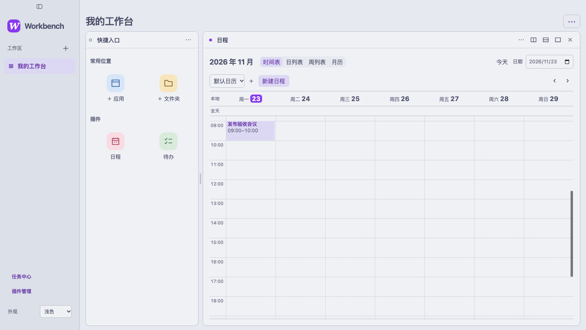

# 工作台工程设计评审入口

宿主与随包插件的通用设计规则见 [DESIGN.md](../DESIGN.md)。本轮改版从[应用前端 UI 重构方案](plans/frontend-redesign.md)进入，其中列出组合稿、源码落点、兼容策略和产品验收步骤。

当前阶段为 M0 插件核心验证。Electron 预览包已支持工作区、递归窗格、插件后台任务和备份恢复。完整 M0 验收与 M1 产品开发进度见[实施计划](plans/implementation.md)，已执行的测试与限制见[运行验证记录](qa/evidence/runtime-progress.md)。

安装包保留、Checkpoint 晋级与正式发布归档见[包体管理](releases/README.md)。

## 试用工作台

安装镜像、校验值及首次启动步骤见[macOS 预览版说明](preview-macos.md)。首次进入「快捷入口」后右键「日程」并选择「在旁边打开」，再调整分隔线，可在同一个工作区查看文件夹入口和随宽度切换的日程时间表。

[查看同一布局的深色外观](qa/evidence/tpVe6q-week-dark.png)。两张截图取自 tpVe6q 包内渲染资源，使用无窗口浏览器和临时 SQLite 工作区。核心机制的实测范围与待验项目见[需求与测试追踪矩阵](qa/traceability.md)。

本轮以最新用户要求为准；仅找到 v1.0 原稿，v0.9 正文缺失，因此这是可评审的暂定基线，不声称完成双版本合并。

- [资料索引与证据](product/reference-index.md)
- [差异、缺口与 Demo 审阅](product/review.md)
- [校准 PRD](product/prd.md)
- [需求决策记录](product/decisions.md)
- [整体架构与生命周期](architecture/overview.md)
- [插件运行与信任](architecture/plugin-trust.md)
- [SDK 契约与可运行的插件示例](architecture/sdk.md#在预览包中运行-sdk-示例)
- [框架选型 ADR](adr/001-desktop-runtime.md)
- [其他关键 ADR](adr/002-core-boundaries.md)
- [分阶段实施计划](plans/implementation.md)
- [Spike 计划](plans/spikes.md)
- [需求测试矩阵](qa/traceability.md)
- [本轮文档检查](qa/document-review.md)

标记：C＝本轮用户明确确认；H＝旧稿记载为已确认但本轮未重述；L＝旧稿未确认建议；P＝本轮方案建议；O＝需要用户决定。H 保留，不静默删除。P/L 不因写入文档就成为已批准要求。

阶段统一为 M0 插件核心、M1 产品 MVP；旧稿 M0 验证归入 M0 前置 Spike，旧 M1→新 M0，旧 M2→新 M1，旧 M3→后续。架构方向已获批准，先执行前置技术验证，再依据证据冻结框架并推进核心；业务细项在相应插件开工前冻结。

当前实施进度：[T00 首轮技术验证](qa/evidence/runtime-progress.md)。

## 启动与插件故障恢复

项目根目录运行 `npm start`。工作台菜单栏的「以安全模式重新启动」可暂时暂停插件，打开插件管理页排查故障。应用已退出时也可运行 `npm start -- --safe-mode`。原工作区与启停偏好保留；明确停用有问题的插件后，在菜单栏选择「重新正常启动」。

[macOS 预览版安装、备份与恢复说明](preview-macos.md)
