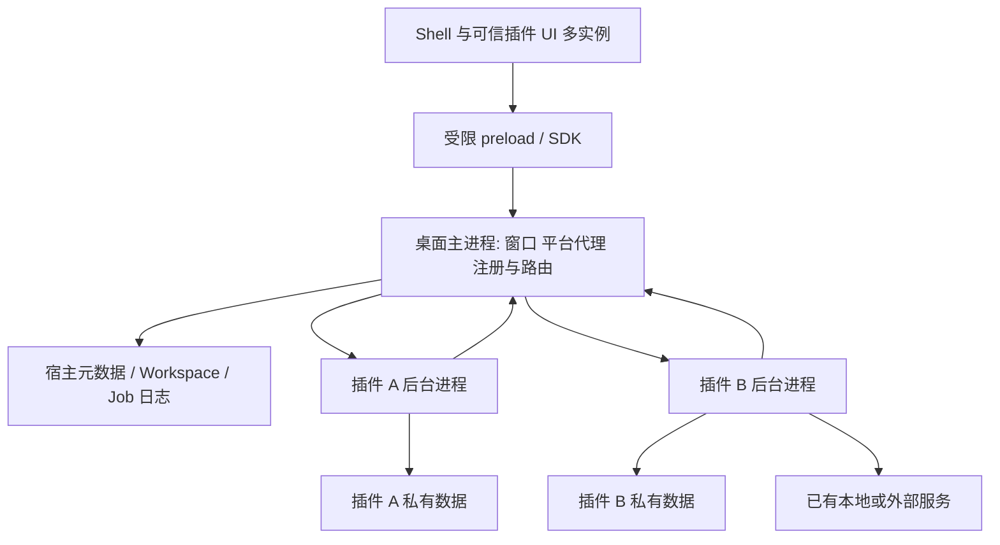

# 整体架构、数据流与生命周期

状态：架构方向与可信基线已获用户确认；实现细节按技术验证结果收敛。Electron优先、Tauri对照，框架待证据冻结。不要将本文误作实现现状。

## 结构

宿主分为 Shell、Workspace Engine、Plugin Registry/Supervisor、Service Router、Job Registry、Persistence、Platform Broker。它们是模块，不是每个都新增一个进程。首版三个逻辑包即可：contracts、sdk、host-core；ui-kit 独立可选包。host-core 内按 workspace/runtime/services/jobs/persistence 分目录，避免提前拆十个发布包。Electron/React 仅在 desktop/UI适配层；contracts 无 DOM/框架依赖，UI SDK 可单独依赖 DOM。

主进程只运行可信宿主模块，负责授权、持久化协调、生命周期与有限 IPC；不 import 业务插件、不做推理/大文件解析。主进程宿主 DB 使用短事务，若实测阻塞再迁至专用 worker，不提前增加常驻数据库进程。每个有后台入口的活跃插件按需拥有一个 utility process；纯 UI 插件无后台进程。同插件多视图共用服务世代。外部模型进程由用户已有服务管理，宿主不因结束自己的进程而声称杀掉外部服务。

UI 模块只从已验证本地不可变版本目录加载，包内相对依赖，拒绝网络脚本/目录逃逸。用宿主受控资源协议按安装 ID+版本映射资源；不用任意文件服务器或 eval。UI entry 是 ESM mount factory，React 只是默认开发套件；首版插件打包自身依赖（UI Kit/token 协议共享，暂不建设运行时依赖共享平台）。CSP、资源路径、原生模块 ABI 与签名后加载均需 Spike。

## 数据与状态归属

宿主 host.sqlite：工作区/实例配置与恢复快照、插件版本/启用/信任记录、服务绑定、任务日志、应用设置。插件私有目录：业务 DB、草稿、结果索引与迁移版本；插件后台唯一写入口。凭据留 OS 保护层，业务配置只存 handle。结果正文与原文件不进入布局 JSON 或控制 IPC。

Workspace = id/name/revision/schemaVersion/layout/activePaneId/views。LayoutNode = leaf(paneId,viewInstanceId?) 或 split(horizontal=左右 / vertical=上下,ratio,first,second)。空布局用空叶规范化；实例唯一归属叶；切分、移动、关闭同时校验引用和 ID。P 建议结构上限深度32、节点255、导入5MiB（安全防滥用值，非 UI 目标）；超过保留原文件并报错。

ViewInstance = id/pluginId/viewType/configVersion/config/stateVersion/state/resource?。配置是筛选/显示偏好；state 是导航或草稿引用；业务内容由插件保存。复制生成新 workspace/pane/instance ID，只复制配置与引用；不复制未提交草稿正文或提交操作。相对日期保存意图，固定日期保存日期；时区与日历计算属于插件。

布局操作经校验→expectedRevision 比较→事务提交→更新保存状态；拖动300ms防抖，结束立即提交。磁盘满/冲突不显示已保存，保留内存草稿与最后有效磁盘版本，提供重试/重新加载。持久化确认的实际 durability 由崩溃测试验证。工作区导入只是配置，不触发安装、授权或资源打开器。

## 启停与故障

1. 启动取得单实例锁→读取设置与宿主恢复记录→只读 Manifest 扫描/校验→构建依赖图→决定是否显示窗口→激活 onAppStart 后台→恢复最后工作区占位→按视图需要激活服务和挂载。登录静默路径仍运行必要提醒服务。
2. 插件 discovered→validated→ready/disabled→activating→active→stopping→disabled；任一步失败可 failed。并发激活合并；启动超时/中途失败撤销所有注册。后台 generation 变化令旧请求/句柄失效，重连先重新发现，不重放写调用。
3. 切区/替换/关格/关窗先 prepareClose，保存或明确放弃后 snapshot，再提交宿主状态，再 dispose 当前视图；dispose 仅清该实例订阅。候选视图挂载失败保留目标配置与错误占位，旧持久快照不销毁。后台不依赖 DOM 存活。
4. 停用先计算任务与必需依赖影响，对所有受影响视图完成关闭检查与保存/明确放弃；任何视图取消则整次停用取消且不dispose。保存阶段服务保持可用；确认全部就绪后停止接受新调用、通知依赖方失效、取消/收束任务、卸载视图、撤销服务。宽限建议5秒；超时终止进程，远端状态未知不可写 cancelled。
5. 服务进程崩溃只标该世代失败；恢复策略建议60秒内最多3次启动，超过手动恢复；写操作绝不自动重试。共享 UI 无限循环可能拖垮整个 Shell；主进程监测无响应并提供安全重启，不承诺 UI 故障隔离。
6. 安全启动在加载任何业务插件之前禁用其执行，恢复宿主与占位，提供逐一重新启用；默认业务插件也不是“不可禁用核心”。

## Job 数据流

提交→先事务写 job+输入摘要+幂等键→发给后台 execute→持久 checkpoint externalId→状态/结果引用更新→订阅通知。相同插件/类型/键且同输入返回原记录，不同输入报冲突。关闭 UI 仅退订，Job 保留。

queued→running→succeeded/failed；running→cancel_requested→cancelled 只在确认停止时成立。执行明确中断用 interrupted；远端是否执行不明用 unknown。取消竞态允许已完成结果优先，不能从终态倒退。重启后 reconcile 查询，支持运行/完成/失败/未知；无 query 能力保持 unknown，人工重试新尝试并提示可能重复。没有跨本地数据库与远端的 exactly-once 保证。

## 升级与恢复

首版不要求热替换：新版本暂存，重启且插件停止后生效；停用也可留到重启完成 UI 模块释放。卸载默认只删包/注册，数据删除是单独明确操作。

迁移：冻结写入口→校验旧版本可用备份→在隔离副本迁移/校验→原子切换活动数据路径与版本记录→激活。记录 pending/committed journal，应对切换一半时崩溃；失败保留旧目录与候选目录，不用旧代码硬读新库。插件快照需要包含 DB/WAL一致状态与结果清单，不只复制主库；afterBackup 在成功失败都释放写锁。宿主与每插件快照分别一致，首版不承诺跨插件全局事务，备份清单记录各自版本与时间。凭据和外部原文件默认不备份。

## 空闲与平台

不复制 Demo 永久300ms轮询。任务更新用事件；不可避免轮询只在任务存在时启动且退避。提醒使用下一截止时间计时并在唤醒对账；不使用阻止睡眠来掩盖调度问题。首版不建设动态租约系统：Manifest声明 backgroundMode=on-demand/resident，默认on-demand；resident用于提醒等持续服务，启用后按onAppStart启动，停用/退出才停止。on-demand在无视图、Job或服务订阅/在途调用60秒后可停止，停止前执行disposer并刷盘。onAppStart仅是触发事件，不自动意味着resident。窗口释放后的进程数量与资源收益需实测。

macOS 关闭不退出；Dock/菜单/热键可重建窗口。退出关闭子进程与计时器，未完成任务留下恢复记录；强杀/系统关机无确认保证。Windows/Linux 仅协议和能力检测兼容设计，移动端另做 Shell 与生命周期，不维护未实际需要的万能 RuntimeAdapter。

迁移实现补充：旧实例先停写并导出一致副本；新版本专用迁移运行器只绑定候选dataDirectory执行prepareData/migrate，禁止普通activate。校验成功、关闭数据库句柄后切换活动目录指针，结束迁移运行器，再以新活动目录启动正常世代。失败不修改旧活动指针；启动恢复通过journal与目录清单选择最后完整提交，不猜测半迁移数据。
